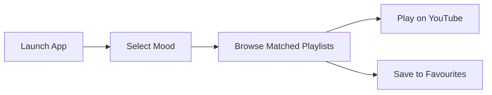

<div align="center">

# 🎵 MoodMelody

**Pick your mood. Get music that fits it.**


<a href="https://play.google.com/store/apps/details?id=com.marwadiuniversity.moodmelody">
  
</a>

[**Features**](#-features) · [**Screenshots**](#-screenshots) · [**Tech Stack**](#-tech-stack) · [**Setup**](#-getting-started) · [**Roadmap**](#-roadmap)

</div>

---

## 📌 Overview

MoodMelody is a published Android app that matches how you feel with curated YouTube playlists. Choose a mood, tap a vibe, and start listening. It removes the "what should I play?" decision by tying music directly to emotional state.


## ✨ Features

| Feature | Description |
|---|---|
| 🎭 **Mood selection** | Log your current mood in one tap |
| 🎧 **Mood-based playlists** | Curated YouTube playlists matched to each mood |
| ⭐ **Favourites** | Save playlists you like |
| 📊 **Mood tracking** | Keep a record of how you feel over time |
| 📱 **Clean UI** | Simple, native Android interface |

## 🔄 User Flow



## 🛠️ Tech Stack

| Category | Tools |
|---|---|
| Platform | Android |
| Language | Kotlin |
| UI | XML layouts |
| Build | Gradle (Kotlin DSL) |
| IDE | Android Studio |
| Distribution | Google Play Store |

## 📂 Project Structure

```
moodmelody-music-mood-tracker/
├── app/
│   └── src/main/
│       ├── java/                # Activities and app logic
│       ├── res/                 # Layouts, drawables, strings
│       └── AndroidManifest.xml
├── gradle/
├── build.gradle.kts
├── settings.gradle.kts
├── gradle.properties
└── README.md
```

## ⚙️ Getting Started

### Prerequisites

Android Studio (latest stable) · Android device or emulator

### 1. Clone

```bash
git clone https://github.com/D-sasmita/moodmelody-music-mood-tracker.git
cd moodmelody-music-mood-tracker
```

### 2. Open and sync

1. Open the folder in Android Studio (**File → Open**).
2. Wait for Gradle to sync, or run **File → Sync Project with Gradle Files**.

### 3. Run

Connect a device or start an emulator, then click ▶ **Run**.

## 🗺️ Roadmap

- [ ] AI-based mood detection
- [ ] Mood analytics dashboard
- [ ] User authentication
- [ ] Cloud sync (Firebase)
- [ ] Dark mode

## 🤝 Contributing

1. Fork the repository
2. Create a branch: `git checkout -b feature/your-feature-name`
3. Commit and push your changes
4. Open a Pull Request

## 📜 License

Released under the [MIT License](LICENSE).

## 👩‍💻 Author

**Sasmita Das**

[](https://github.com/D-sasmita)

---

<div align="center">⭐ If you found this useful, consider starring the repo.</div>
